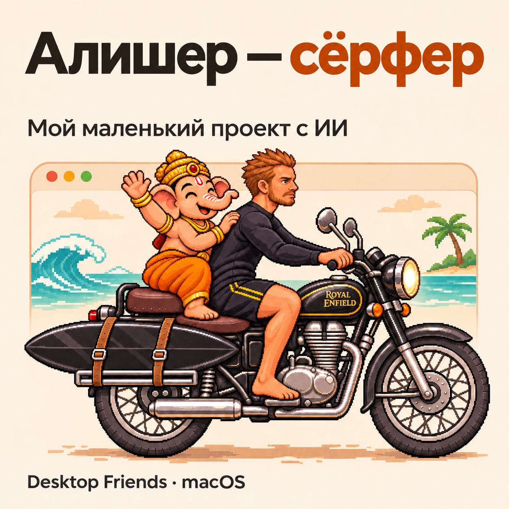

# Desktop Friends · Алишер и Ганешик

Два пиксельных друга для рабочего стола macOS: Алишер-сёрфер с чёрной доской и Ганешик. Они приезжают на чёрном мотоцикле, ловят волны и отдыхают под пальмой.

## Скачать

[Скачать Desktop Friends 0.6.1 для macOS (ZIP)](https://github.com/Marfys9/desktop-friends-downloads/releases/download/v0.6.1/Desktop-Friends-0.6.1-macOS.zip)

[Все выпуски](https://github.com/Marfys9/desktop-friends-downloads/releases). В блоке Assets нужен файл `Desktop-Friends-0.6.1-macOS.zip`. Архивы GitHub **Source code** не содержат готового приложения.

Для macOS 14 или новее. В одном приложении Apple Silicon и Intel. Сборка проверена на Apple Silicon и для Intel-части через Rosetta; на физическом Intel Mac и macOS 14 отдельного запуска не было.

## Установка

1. Распаковать ZIP.
2. Перенести `Desktop Friends.app` в «Программы» и открыть.
3. Управление находится под значком 🤙 в строке меню.

Приложение подписано локально, без Developer ID и notarization Apple. При первом запуске macOS может показать блокировку. Официальная инструкция Apple: [безопасное открытие приложений на Mac](https://support.apple.com/ru-ru/102445). Разрешение конкретному приложению даёт владелец Mac. Отключать защиту системы и запускать команды в Терминале не требуется.

## Что можно попробовать

- Вытянуть волну вверх и отпустить.
- Нажать на Алишера: ещё одна последняя волна.
- Поднять Алишера повыше: Ганешик подстрахует.
- Дважды нажать на мотоцикл с паузой между кликами: посадка и поездка.
- Выбрать ненужный файл через пульт: после подтверждения Ганешик отправит его в обычную восстанавливаемую Корзину. Корзина не очищается. Прямой перенос из Finder не подтверждён, используйте пульт.

Звука пока нет. Приложение работает локально, не читает переписки и не требует аккаунта.

## Свой вариант

[Промпт для создания своих персонажей](PROMPT-ru.txt). Подставьте внешность, увлечения и фотографии своих героев.

Это отдельная страница скачивания. Исходный код проекта хранится в приватном репозитории.
